<a href="https://taco-man.in">
  <picture>
    <source media="(prefers-color-scheme: dark)" srcset="assets/header-dark.svg">
    
  </picture>
</a>

  
  
  
  

I build software through two lenses: **developer velocity** and **systemic reliability**.
Mostly that means utility software that removes friction nobody else wants to deal with.

### Now

- **Building Knots**, an automated documentation platform that replaces the spreadsheets global exporters run on.
- **Experimenting with [Taco](https://github.com/tac0mania/taco)**, a lossless compressor that uses a language model, run with integer arithmetic only so every machine gets the same bits.
- **Learning** high-performance computing and the mechanics of mid-frequency trading.
- **Ask me about** Next.js, backends, GenAI, TypeScript and system architecture.

### Selected work

<table>
  <tr>
    <td width="50%" valign="top">
      <h4><a href="https://github.com/tac0mania/taco">taco 🌮</a></h4>
      Lossless compression with GPT-2. A range coder stores only what the model did not predict.
      The engine, HardShell, uses integers only, so a file folded on a Mac unfolds on Linux x86.
        <code>Rust</code> · alpha
    </td>
    <td width="50%" valign="top">
      <h4><a href="https://youtu.be/Jl8dUHrggV4">MockQL</a></h4>
      A GraphQL interceptor and mocking tool, for building and testing
      frontends without waiting on the backend. <a href="https://youtu.be/Jl8dUHrggV4">Watch the demo ↗</a>
        <code>TypeScript</code> · <code>GraphQL</code>
    </td>
  </tr>
</table>

<b>Featured build:</b> MockQL demo

 

### Toolbox

 

Building “unsexy” but highly effective utilities.

